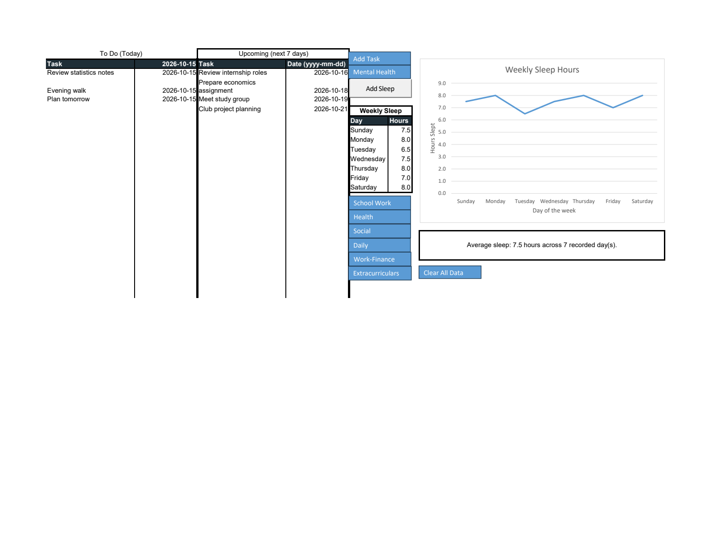
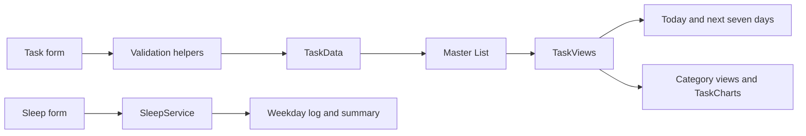
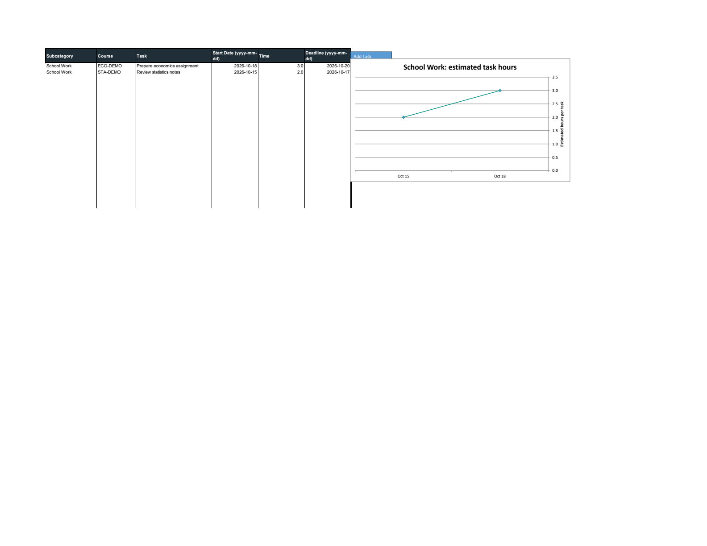

# VBA Time Management Support Tool

An Excel application that brings categorized tasks, a daily plan, upcoming work and a weekly sleep log into one workbook.

[Open the workbook](Group%2021%20Time%20Managemnt%20Tool.xlsm) · [Architecture](docs/ARCHITECTURE.md) · [VBA source](src/README.md) · [Tests](docs/TESTING.md)



*Actual Excel output with synthetic demonstration data. The screenshot's task dates are relative to the capture date, October 15, 2026. The distributed workbook retains its original inputs.*

## What it does

| Workflow | Result |
| --- | --- |
| Add a task | Save a category, task name, start date and estimated hours |
| Add school work | Also require a course and a due date on or after the start date |
| Review categories | Rebuild six category views from the Master List and sort by descending start date |
| Plan the day | Show tasks whose start date is today |
| Look ahead | Show tasks starting tomorrow through seven days from today, inclusive |
| Record sleep | Save 0–24 hours for a selected weekday and average only recorded days |

Categories are **School Work, Health, Social, Daily, Work-Finance and Extracurriculars**. Task charts show estimated hours per task. They do not measure actual time spent or productivity.

## Try it

1. Download the workbook above and open a local copy in desktop Excel with VBA available. The verified environment is Windows Excel 16.0.
2. On `To-do and Sleep`, select **Add Task**. Enter the task details; selecting School Work reveals course and due-date fields.
3. Submit the task. It is saved once in `Master List`, then category views, charts and daily/upcoming lists refresh.
4. Select **Add Sleep**, choose a weekday and enter a number between 0 and 24. Updating a weekday replaces that slot's prior value.
5. Use the category navigation controls to review tasks. The dashboard refreshes when the workbook opens with macros available. After editing source cells directly, run `RefreshDashboard` from Excel's macro dialog.

`Master List` is the task source of truth. Category sheets are derived views, so direct edits there are replaced by the next refresh. Category clear controls delete matching tasks from the master and refresh the views. The master clear control deletes all tasks while retaining sleep entries. Use a working copy to explore clear controls.

## How it is organized



| Layer | Responsibility |
| --- | --- |
| Forms | Collect input, validate before saving and retain invalid submissions for correction |
| `WorkbookSupport` | Resolve this workbook's sheets and parse dates/numbers |
| `TaskData` | Validate and write the master record; delete tasks by category |
| `TaskViews` | Rebuild category, daily and upcoming views from the master |
| `TaskCharts` | Maintain one named duration chart per populated category |
| `SleepService` | Validate weekday entries and calculate the recorded-day average |
| `Module1`–`Module5` | Preserve existing navigation, chart, sorting and clear macro entry points |



*The category screenshot uses synthetic tasks. The line connects individual task estimates; multiple tasks may share a date.*

## Repository

```text
README.md
*.xlsm                  Runnable application and form designers
src/
  modules/              Standard VBA modules
  forms/                UserForm code snapshots
  host/                 Workbook and worksheet event snapshots
  legacy/               Original loose snippets, including the duplicated HelpButton file
  manifest.json         Workbook and component hashes
docs/                   Architecture, testing and demonstration images
scripts/                Source extraction and native Excel test runner
tests/vba/              Disposable-workbook smoke tests and demo fixture
```

Form snapshots contain code only. Full designer resources remain in the workbook; see the [source editing contract](src/README.md).

## What changed in this revision

- Separated task persistence, derived views, chart rendering and sleep logic.
- Validated dates, positive estimated hours, school deadlines and sleep boundaries before writing.
- Rebuilt daily/upcoming results after clearing their previous contents.
- Replaced repeated full-column scans and active-sheet data writes with bounded, explicit worksheet operations.
- Prevented chart accumulation and repaired navigation to a nonexistent `Graphs` sheet.
- Preserved the original Group 21 workbook attribution and existing button entry points.

## Verification and current scope

Native Excel tests cover form initialization and school-field visibility, invalid dates/durations, deadline ordering, category synchronization, today/next-seven-days boundaries, sorting, deletion, chart counts, another active workbook and recorded-day sleep averages. See [test instructions and results](docs/TESTING.md).

The task lists use **start dates**, including for upcoming work. The workbook has no completion status, recurring-task engine, automatic time tracking or calendar integration. Sleep is stored in seven weekday slots with no date history, and its summary is descriptive. The original resource-link form is retained; its external destinations were not validated in this revision.
